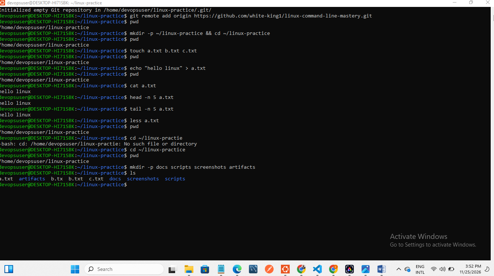
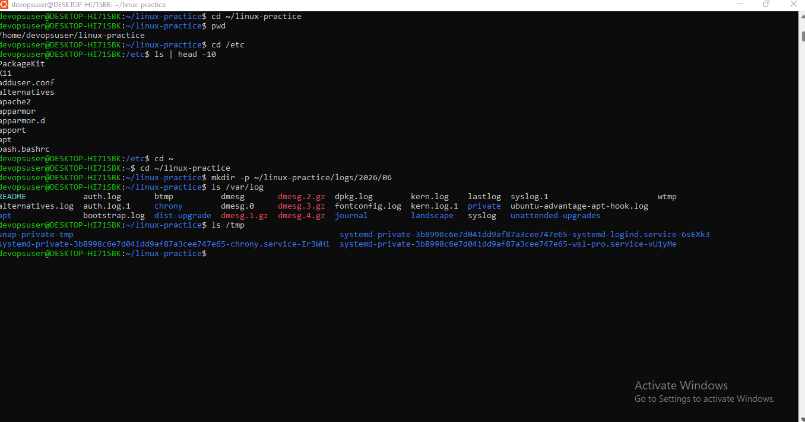
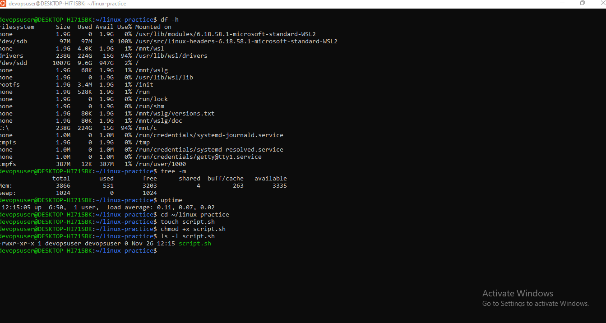
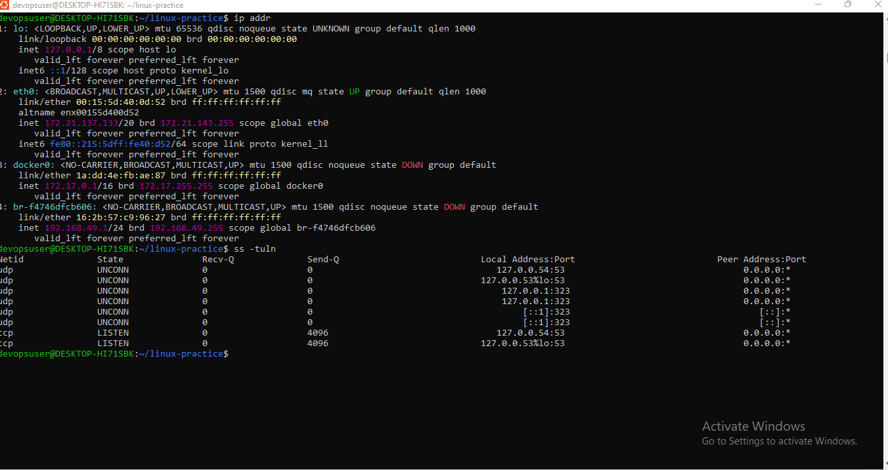
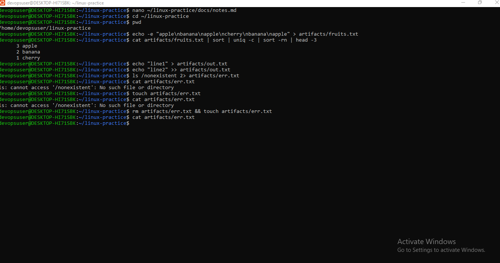
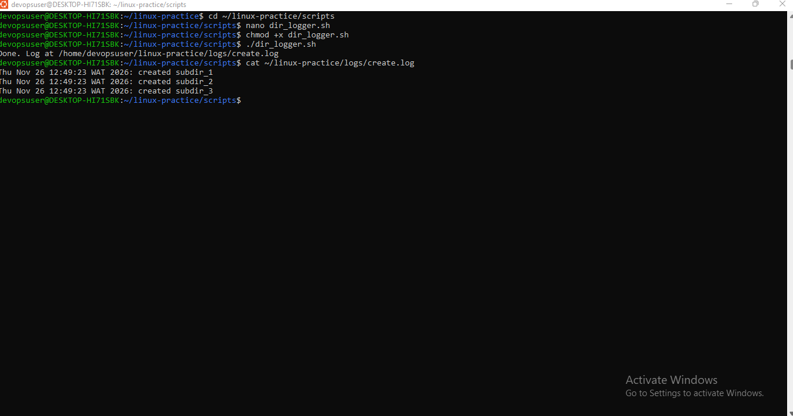

# Linux CLI Practice Notes

## Task 1: File Management

### What I did
- Created a.txt b.txt c.txt with `echo "hello linux" > a.txt`
- Viewed it with `cat`, `head -n 5`, `tail -n 5`, `less`
- Found files with `find ~/linux-practice -name "*.txt"`
- Searched content with `grep "hello" artifacts/a.txt`

### Key command outputs
$ cat artifacts/a.txt
hello linux

$ head -n 5 artifacts/a.txt
hello linux

$ grep "hello" artifacts/a.txt
hello linux

### Observation
- `head` defaults to 10 lines; `-n 5` limits to 5
- `less` pages through the file; `q` exits
- `grep` prints lines containing the match

### Problems & fixes
- Typed `tail -n 5 artifcats/a.txt` by mistake → got "No such file or directory" → fixed by typing the correct artifacts

### Evidence

## Task 2: Directory Navigation

### What I did
- Used `pwd` to confirm location
- Navigated with `cd /etc` (absolute) and `cd ~` (home)
- Created nested folders with `mkdir -p ~/linux-practice/logs/2026/06`
- Explored `/etc`, `/var/log`, `/tmp`

### Key command outputs
$ pwd
/home/devopsuser/linux-practice

$ ls | head -10
(10 entries from /etc)

### Observation
- `/etc` = system config files
- `/var/log` = log files
- `/tmp` = temporary files, cleared on reboot
- `mkdir -p` creates parent folders automatically

### Problems & fixes
(none)

### Evidence

- ...

## Task 3: System Monitoring

### What I did
- `ps aux | head -5` to see running processes
- `top` for real-time view (q to quit)
- `df -h` for disk usage
- `free -m` for memory in MB
- `uptime` for system uptime
- `chmod +x script.sh` to add execute permission
- `ls -l script.sh` to confirm `rwx`

### Key command outputs
$ df -h
Filesystem      Size  Used Avail Use% Mounted on
...

$ ls -l script.sh
-rwxr-xr-x 1 devopsuser devopsuser 0 ... script.sh

### Observation
- `chmod +x` adds execute permission; `ls -l` shows `rwx` when successful
- `-h` = human-readable (GB/MB); `-m` = megabytes

### Problems & fixes
(none)

### Evidence

## Task 4: Networking Basics

### What I did
- `ping -c 4 8.8.8.8` to test external connectivity (4 packets)
- `ping -c 4 google.com` to test DNS + external network
- `ip addr` to see IP addresses of interfaces
- `ss -tuln` to see listening TCP/UDP ports

### Key command outputs
$ ip addr
(interfaces and IP addresses shown)

$ ss -tuln
(port list shown)

### Observation
- Newer systems use `ip` and `ss` instead of `ifconfig` and `netstat`
- `-tuln` = TCP + UDP + listening + numeric ports

### Problems & fixes
(if ping blocked on cloud, note it here)

### Evidence

## Task 5: Pipes and Redirection

### What I did
- Created/edited `docs/notes.md` with `nano`, then confirmed working directory with `cd` + `pwd`
- Wrote a multi-line fruit list to `artifacts/fruits.txt` using `echo -e` with `>`
- Counted the top 3 fruits with `cat | sort | uniq -c | sort -rn | head -3`
- Created `artifacts/out.txt` with `>` (line1) and appended to it with `>>` (line2)
- Redirected `ls /nonexistent` stderr to `artifacts/err.txt` with `2>`
- Cleared the error log using `rm artifacts/err.txt && touch artifacts/err.txt`, then verified with `cat`

### Key command outputs
$ cat artifacts/fruits.txt | sort | uniq -c | sort -rn | head -3
      3 apple
      2 banana
      1 cherry

$ ls /nonexistent 2> artifacts/err.txt
$ cat artifacts/err.txt
ls: cannot access '/nonexistent': No such file or directory

$ rm artifacts/err.txt && touch artifacts/err.txt
$ cat artifacts/err.txt
(no output — file is empty)

### Observation
- `>` overwrites a file; `>>` appends to it
- `2>` redirects stderr only (stdout stays on the terminal)
- `uniq -c` only counts adjacent duplicates → `sort` must run first
- `sort -rn` = reverse numeric sort (descending)
- `touch` on an existing file only updates its timestamp — it does not truncate content

### Problems & fixes
- Wrong fruit counts without `sort` first — duplicates weren't adjacent, so `uniq -c` undercounted. Fixed by adding `sort` before `uniq`
- `touch artifacts/err.txt` did not clear the file — `cat` still showed the old `ls` error. `touch` only creates/updates timestamps; it never empties a file. Fixed with `rm artifacts/err.txt && touch artifacts/err.txt` (alternatives: `> artifacts/err.txt` or `truncate -s 0 artifacts/err.txt`). Verified empty with `cat`

### Evidence

## Task 6: Shell Scripting

### What I did
- Wrote dir_logger.sh with variables, if, and for loop
- Made it executable with `chmod +x`
- Ran it with `./dir_logger.sh`
- Verified log with `cat ~/linux-practice/logs/create.log`

### Key command outputs
$ ./dir_logger.sh
Done. Log at /home/devopsuser/linux-practice/logs/create.log

$ cat ~/linux-practice/logs/create.log
(three lines showing date: created subdir_1/2/3)

### Observation
- `#!/bin/bash` = shebang, tells system to use bash
- `chmod +x` is required before `./script.sh` works
- `>>` appends log lines; `>` would overwrite each run

### Problems & fixes
(any errors here, e.g. Permission denied → forgot chmod)

### Evidence

